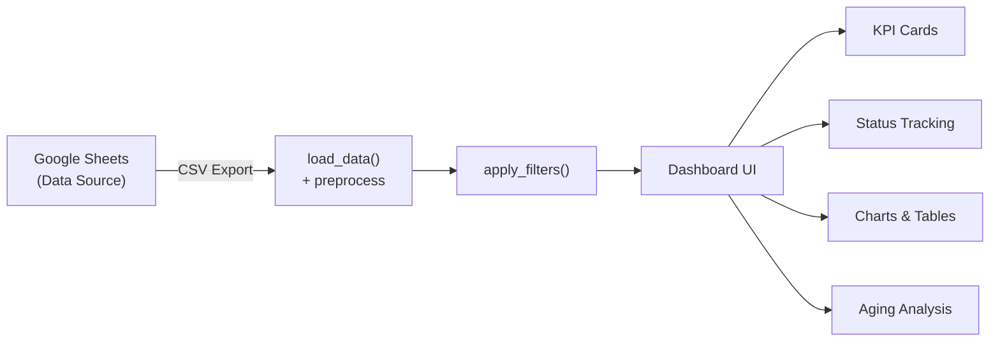
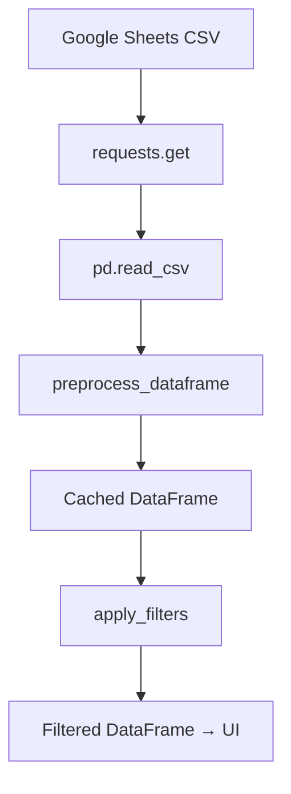
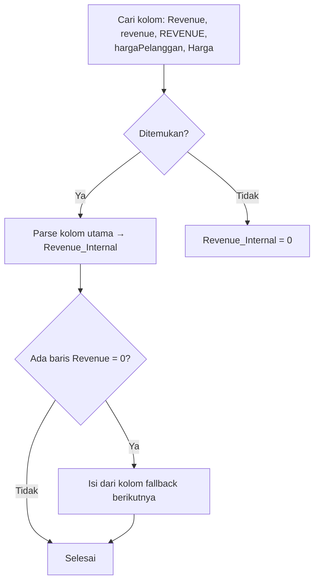
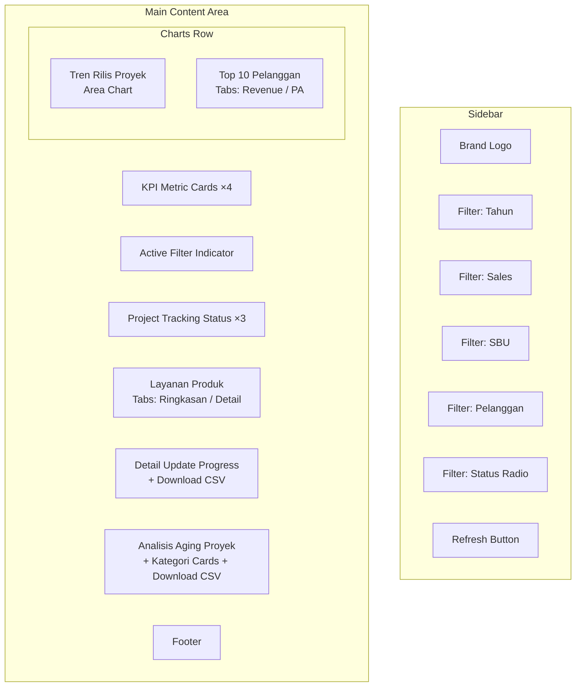
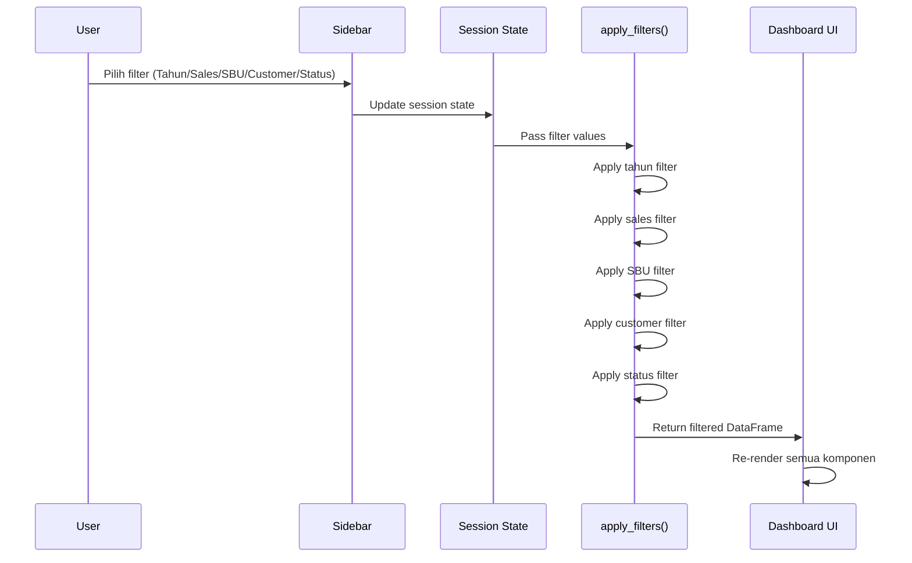

# 📖 Dokumentasi Kode — Projek Dashboard Manufaktur

> **Versi**: 3.0 (Streamlit Edition)
> **File Utama**: [`app.py`](file:///d:/Projek%20Coding/dashboardsales-streamlit/app.py)
> **Dependencies**: [`requirements.txt`](file:///d:/Projek%20Coding/dashboardsales-streamlit/requirements.txt)

---

## 1. Gambaran Umum

Aplikasi ini adalah **dashboard analisis performa manufaktur** berbasis [Streamlit](https://streamlit.io/) yang menampilkan data penjualan (sales) dari Google Sheets secara real-time. Dashboard menampilkan KPI, grafik tren, tabel pelanggan, status proyek, dan analisis aging — dengan tema dark minimalist (hitam-putih netral, modern, dan nyaman di mata).



---

## 2. Arsitektur & Alur Data

### 2.1 Sumber Data

| Parameter | Nilai |
|-----------|-------|
| **Sumber** | Google Sheets (public CSV export) |
| **URL** | Dikonfigurasi via environment variable `GOOGLE_SHEETS_URL` |
| **Fallback** | URL default hard-coded ke spreadsheet ID `13FsF4_YmbwgaFuyN5hOZwTLQFS0xHgDbKJYUB3jN9OU` |
| **Cache** | 5 menit (`ttl=300`) menggunakan `st.cache_data` |
| **Retry** | 3 kali percobaan dengan jeda 2 detik |

### 2.2 Pipeline Data



---

## 3. Struktur File

```
dashboardsales-streamlit/
├── app.py              # Seluruh logika aplikasi (979 baris)
└── requirements.txt    # Daftar dependensi Python
```

---

## 4. Dependensi

Didefinisikan di [`requirements.txt`](file:///d:/Projek%20Coding/dashboardsales-streamlit/requirements.txt):

| Package | Versi | Kegunaan |
|---------|-------|----------|
| `streamlit` | 1.23.1 | Framework web UI utama |
| `pandas` | 1.3.5 | Manipulasi dan analisis data tabular |
| `plotly` | 5.18.0 | Visualisasi chart interaktif |
| `requests` | 2.31.0 | HTTP client untuk fetch data dari Google Sheets |
| `openpyxl` | 3.1.3 | Engine baca/tulis file Excel (pendukung pandas) |

---

## 5. Referensi Fungsi

### 5.1 `preprocess_dataframe(df)` — [Baris 305–399](file:///d:/Projek%20Coding/dashboardsales-streamlit/app.py#L305-L399)

Memproses DataFrame mentah dari Google Sheets menjadi format internal yang konsisten. Merupakan replika dari `backend/main.py`.

**Parameter:**
- `df` (`pd.DataFrame`) — DataFrame mentah dari CSV Google Sheets.

**Return:** `pd.DataFrame` — DataFrame yang telah dinormalisasi.

**Kolom Internal yang Dihasilkan:**

| Kolom Output | Sumber | Deskripsi |
|--------------|--------|-----------|
| `IDPA_Internal` | `IDPA` | ID Proyek Aktif, dibersihkan dari `.0` trailing |
| `Revenue_Internal` | `Revenue` / `hargaPelanggan` / `Harga` | Nilai pendapatan numerik (float), dibersihkan dari format Rupiah |
| `Status_Cek` | `STATUS SO` + `statusPA` | Gabungan status (uppercase) untuk filtering |
| `UPDATE_Internal` | `UPDATE` | Catatan progress terkini |
| `Date_Internal` | `CREATEDON` / `Date` / `Tanggal` | Tanggal rilis (datetime) |
| `Aging_Hari` | Dihitung dari `Date_Internal` | Selisih hari dari tanggal rilis ke hari ini |
| `Tahun_Filter` | Dihitung dari `Date_Internal` | Tahun rilis untuk filtering |
| `Produk_Internal` | `namaProduk` / `Produk` / `Product` | Nama produk yang dinormalisasi |
| `Customer_Internal` | `CUSTOMERNAME` / `Pelanggan` | Nama pelanggan (uppercase, normalisasi PT/TBK) |
| `namaSales` | `namaSales` / `Sales` | Nama tenaga penjual |
| `SBUNODE` | `SBUNODE` / `SBU` | Kode Strategic Business Unit |

> [!NOTE]
> Fungsi ini melakukan **column name fallback** — mencari beberapa kemungkinan nama kolom untuk setiap field, sehingga kompatibel dengan variasi format spreadsheet.

**Logika Revenue Fallback:**



---

### 5.2 `load_data()` — [Baris 402–418](file:///d:/Projek%20Coding/dashboardsales-streamlit/app.py#L402-L418)

Mengambil data dari Google Sheets dengan mekanisme retry dan caching.

**Return:** `pd.DataFrame` — DataFrame yang telah di-preprocess, atau DataFrame kosong jika gagal.

**Fitur:**
- **Caching**: `@st.cache_data(ttl=300)` — data di-cache selama 5 menit
- **Retry**: Maksimal 3 kali percobaan dengan jeda 2 detik antar percobaan
- **Timeout**: 30 detik per request
- **Error handling**: Menampilkan pesan error Streamlit jika semua percobaan gagal

---

### 5.3 `apply_filters(df, tahun, sales, sbu, status, customer)` — [Baris 421–452](file:///d:/Projek%20Coding/dashboardsales-streamlit/app.py#L421-L452)

Menerapkan filter multi-dimensi pada DataFrame.

**Parameter:**

| Parameter | Tipe | Deskripsi |
|-----------|------|-----------|
| `df` | `pd.DataFrame` | DataFrame sumber |
| `tahun` | `str` | Filter tahun (`"Semua Tahun"` = tidak filter) |
| `sales` | `str` | Filter nama sales (`"Semua Sales"` = tidak filter) |
| `sbu` | `str` | Filter SBU (`"Semua SBU"` = tidak filter) |
| `status` | `str` | Filter status: `"SEMUA"`, `"OPEN"`, `"CLOSE"`, `"CANCEL"` |
| `customer` | `str` | Filter pelanggan (`"Semua Pelanggan"` = tidak filter) |

**Logika Status Filter:**

| Status | Kondisi |
|--------|---------|
| `OPEN` | `Status_Cek` mengandung "OPEN" **DAN** tidak mengandung "CANCEL" |
| `CLOSE` | `Status_Cek` mengandung "CLOSE" |
| `CANCEL` | `Status_Cek` mengandung "CANCEL" |

---

### 5.4 `format_currency(val)` — [Baris 455–457](file:///d:/Projek%20Coding/dashboardsales-streamlit/app.py#L455-L457)

Memformat angka ke format mata uang Rupiah Indonesia.

**Contoh:** `format_currency(1500000)` → `"Rp 1.500.000"`

---

### 5.5 `format_durasi(hari)` — [Baris 460–475](file:///d:/Projek%20Coding/dashboardsales-streamlit/app.py#L460-L475)

Mengkonversi jumlah hari menjadi string durasi yang mudah dibaca.

**Contoh:**
- `format_durasi(400)` → `"1 Tahun 1 Bulan 5 Hari"`
- `format_durasi(45)` → `"1 Bulan 15 Hari"`
- `format_durasi(7)` → `"7 Hari"`

---

### 5.6 `kategori_aging(hari)` — [Baris 478–490](file:///d:/Projek%20Coding/dashboardsales-streamlit/app.py#L478-L490)

Mengkategorikan umur proyek berdasarkan jumlah hari.

| Rentang | Kategori |
|---------|----------|
| 0–14 hari | `"0-14 Hari"` |
| 15–30 hari | `"15-30 Hari"` |
| 31–365 hari | `"31-365 Hari"` |
| > 365 hari | `"> 365 Hari"` |

---

## 6. Komponen UI Dashboard

### 6.1 Layout Keseluruhan



### 6.2 Deskripsi Setiap Seksi

#### KPI Metric Cards — [Baris 607–650](file:///d:/Projek%20Coding/dashboardsales-streamlit/app.py#L607-L650)

4 kartu metrik utama di baris atas:

| Kartu | Metrik | Warna |
|-------|--------|-------|
| Total Proyek (PA) | Jumlah ID PA unik | `#00d2ff` (cyan) |
| Total Pendapatan | Sum Revenue_Internal | `#00df9a` (hijau) |
| Active Projects | Jumlah proyek OPEN | `#3aedff` (light cyan) |
| Conversion Rate | CLOSE ÷ Total PA × 100 | `#ff7f0e` (oranye) |

#### Project Tracking Status — [Baris 670–705](file:///d:/Projek%20Coding/dashboardsales-streamlit/app.py#L670-L705)

3 kartu status proyek (OPEN / CLOSE / CANCEL) yang dihitung **tanpa** filter status aktif, agar angka selalu menunjukkan distribusi sebenarnya.

#### Chart: Tren Rilis Proyek Per Bulan — [Baris 714–747](file:///d:/Projek%20Coding/dashboardsales-streamlit/app.py#L714-L747)

- **Tipe**: Area chart (Plotly `go.Scatter` dengan `fill='tozeroy'`)
- **Data**: Jumlah PA unik per bulan
- **Fitur**: Spline smoothing, custom hover template, label bulan Indonesia

#### Chart: Top 10 Pelanggan — [Baris 750–811](file:///d:/Projek%20Coding/dashboardsales-streamlit/app.py#L750-L811)

Dua tab:
- **By Revenue**: Horizontal bar chart dengan gradient colorscale
- **By PA**: Tabel dataframe dengan kolom Sales, SBU, Jumlah PA, Revenue

#### Tabel: Layanan Produk — [Baris 817–861](file:///d:/Projek%20Coding/dashboardsales-streamlit/app.py#L817-L861)

Dua tab:
- **Ringkasan Produk**: Total transaksi, total PT pembeli, top pelanggan per produk
- **Detail Pembeli per Produk**: Breakdown setiap pasangan produk-pelanggan

#### Tabel: Detail Update Progress — [Baris 867–905](file:///d:/Projek%20Coding/dashboardsales-streamlit/app.py#L867-L905)

Tabel lengkap progress per proyek dengan kolom: Nama Pelanggan, Sales, SBU, IDPA, Revenue, Status SO, dan catatan On Progress. Mendukung **download CSV**.

#### Tabel: Analisis Aging Proyek — [Baris 911–964](file:///d:/Projek%20Coding/dashboardsales-streamlit/app.py#L911-L964)

- 4 kartu ringkasan kategori aging (0-14, 15-30, 31-365, >365 hari)
- Tabel detail dengan Tanggal Rilis, Total Hari, Durasi (format baca), Kategori
- Mendukung **download CSV**

---

## 7. Sistem Styling (CSS)

Tema CSS custom didefinisikan di [Baris 23–292](file:///d:/Projek%20Coding/dashboardsales-streamlit/app.py#L23-L292) menggunakan `st.markdown` dengan `unsafe_allow_html=True`.

### 7.1 Design System

| Token | Nilai | Kegunaan |
|-------|-------|----------|
| **Background** | `#0e1117` | Latar utama aplikasi |
| **Sidebar BG** | `#111827` | Latar sidebar |
| **Primary Accent** | `#00d2ff` | Hover, highlight, border aktif |
| **Success** | `#00df9a` | Revenue, CLOSE status |
| **Warning** | `#ff7f0e` | Aging menengah, conversion rate |
| **Danger** | `#ff4b4b` | CANCEL status, aging kritis |
| **Text Primary** | `#fafafa` | Teks utama |
| **Text Secondary** | `#94a3b8` | Label, subtext |
| **Text Tertiary** | `#64748b` | Subtext minor |
| **Font Heading** | `Outfit` | Heading dan angka metrik |
| **Font Body** | `Inter` | Teks umum |

### 7.2 Komponen CSS

| Class | Deskripsi |
|-------|-----------|
| `.glass-card` | Kartu glassmorphism dengan backdrop-filter blur |
| `.metric-card` | Kartu KPI dengan hover lift effect (-4px translateY) |
| `.status-card` | Kartu status clickable dengan hover glow |
| `.section-title` | Heading seksi dengan font Outfit |
| `.filter-active-bar` | Bar indikator filter aktif dengan animated pulse dot |
| `.fade-in` | Animasi fadeInUp (opacity + translateY) |
| `.sidebar-brand` | Brand header di sidebar |

### 7.3 Animasi

| Animasi | Deskripsi |
|---------|-----------|
| `fadeInUp` | Fade-in dari bawah ke atas (15px), durasi 0.5s |
| `pulse-animation` | Pulsating dot effect pada filter indicator, durasi 1.5s infinite |
| Hover transforms | translateY(-3px/4px) pada card hover |

---

## 8. State Management

Aplikasi menggunakan `st.session_state` untuk menyimpan status filter:

| Key | Default | Kegunaan |
|-----|---------|----------|
| `status_filter` | `"SEMUA"` | Status filter aktif (SEMUA/OPEN/CLOSE/CANCEL) |
| `filter_year` | Index 0 | Selectbox tahun (managed by Streamlit) |
| `filter_sales` | Index 0 | Selectbox sales (managed by Streamlit) |
| `filter_sbu` | Index 0 | Selectbox SBU (managed by Streamlit) |
| `filter_customer` | Index 0 | Selectbox pelanggan (managed by Streamlit) |
| `filter_status_radio` | Index sesuai `status_filter` | Radio button status |

---

## 9. Cara Menjalankan

### Prasyarat
- Python 3.8+
- pip

### Instalasi & Run

```bash
# 1. Install dependencies
pip install -r requirements.txt

# 2. (Opsional) Set custom Google Sheets URL
set GOOGLE_SHEETS_URL=https://docs.google.com/spreadsheets/d/YOUR_ID/export?format=csv

# 3. Jalankan aplikasi
streamlit run app.py
```

Aplikasi akan terbuka di browser pada `http://localhost:8501`.

---

## 10. Konfigurasi

| Environment Variable | Default | Deskripsi |
|---------------------|---------|-----------|
| `GOOGLE_SHEETS_URL` | URL spreadsheet default | URL export CSV Google Sheets |

> [!IMPORTANT]
> Google Sheet harus di-publish atau diset aksesnya ke "Anyone with the link" agar endpoint CSV export dapat diakses tanpa autentikasi.

---

## 11. Fitur Utama

| Fitur | Deskripsi |
|-------|-----------|
| **Real-time Data Sync** | Data otomatis di-refresh setiap 5 menit dari Google Sheets |
| **Multi-Filter** | Filter berdasarkan Tahun, Sales, SBU, Pelanggan, dan Status secara bersamaan |
| **Interactive Charts** | Plotly chart dengan hover tooltip dan smooth animations |
| **CSV Export** | Download tabel Progress dan Aging sebagai file CSV |
| **Responsive Layout** | Layout kolom adaptif menggunakan `st.columns` |
| **Dark Minimalist UI** | Tema dark modern hitam-putih, permukaan charcoal/hitam bersih, border netral, dan tipografi jelas tanpa warna neon mencolok |
| **Manual Refresh** | Tombol refresh data untuk force-clear cache |
| **Column Fallback** | Otomatis mendeteksi berbagai format nama kolom dari spreadsheet |

---

## 12. Diagram Alur Filter



> [!TIP]
> Status count (OPEN/CLOSE/CANCEL) dihitung dari `df_no_status` — yaitu DataFrame yang di-filter tanpa status filter — sehingga distribusi status selalu akurat terlepas dari status filter yang aktif.
